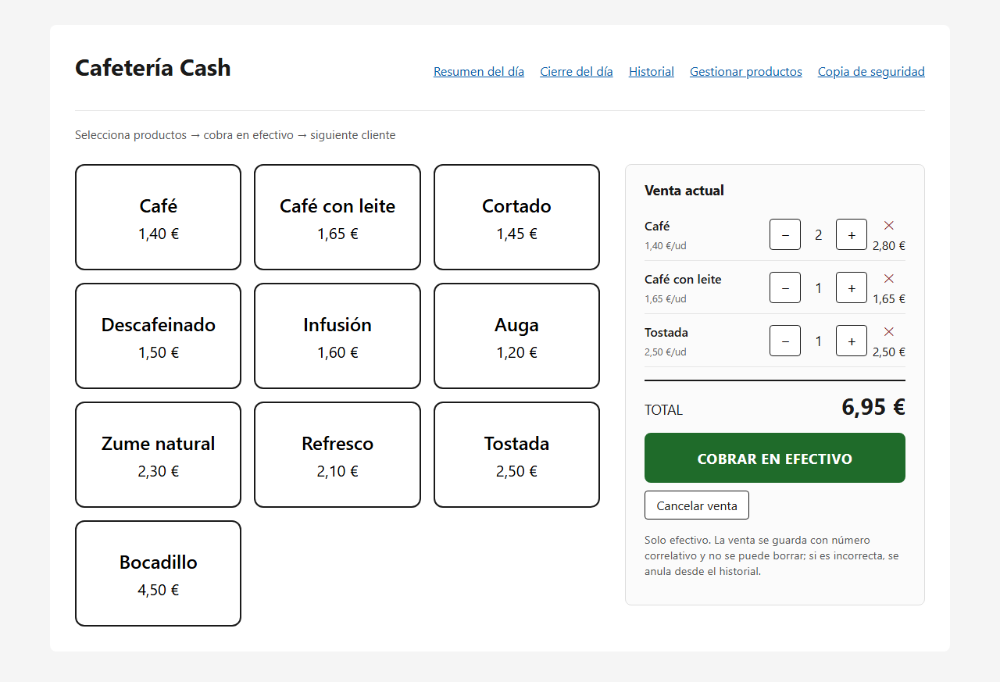
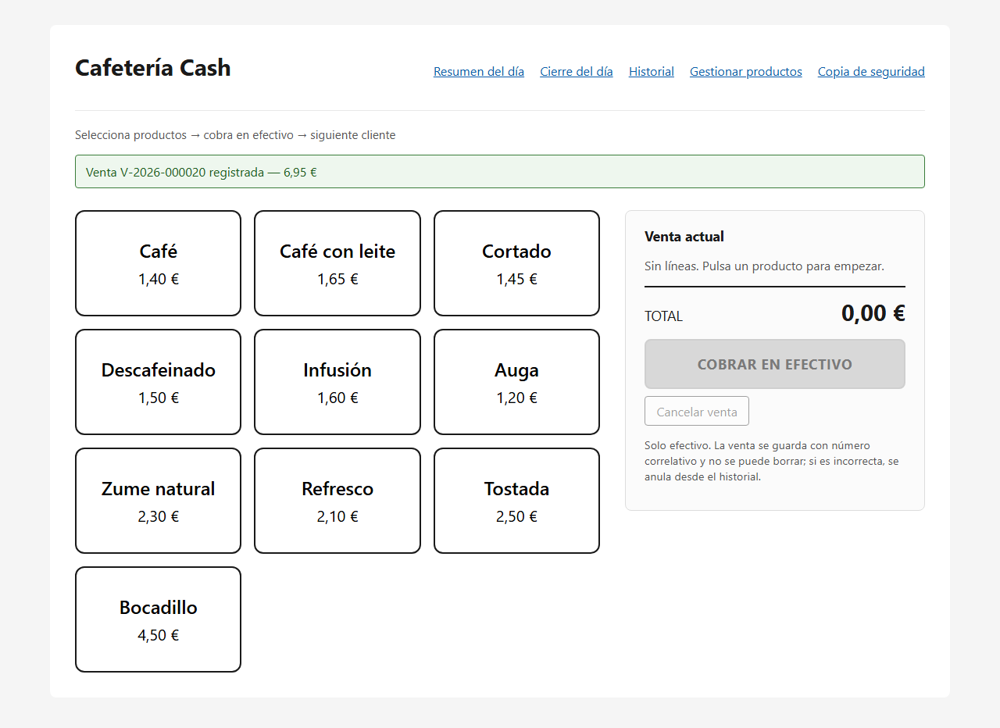
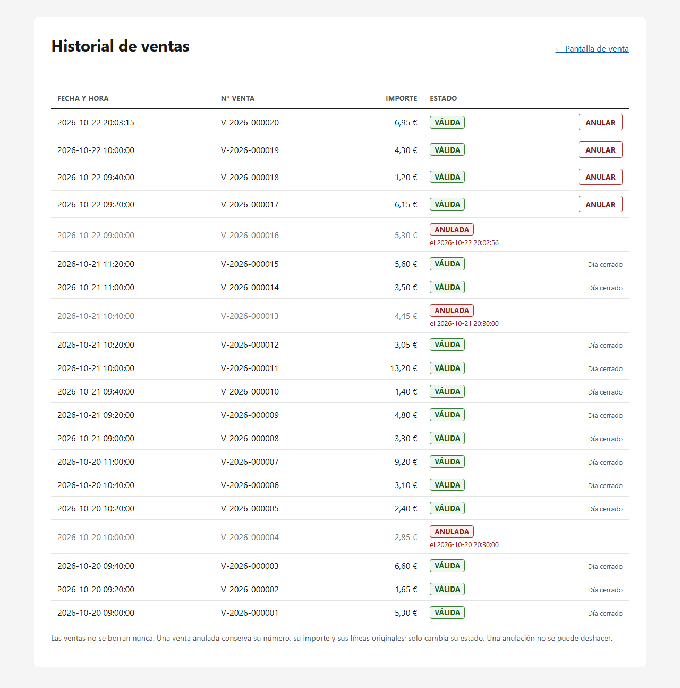
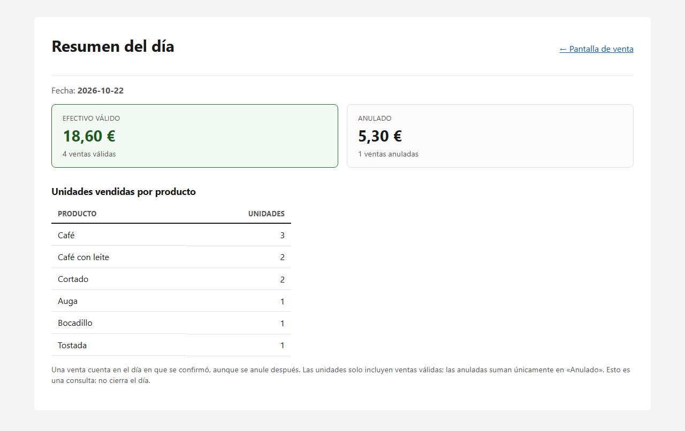
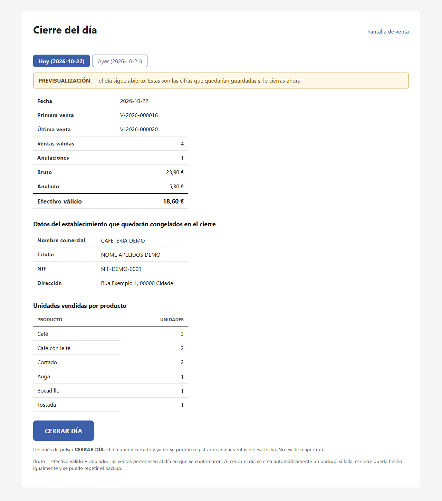
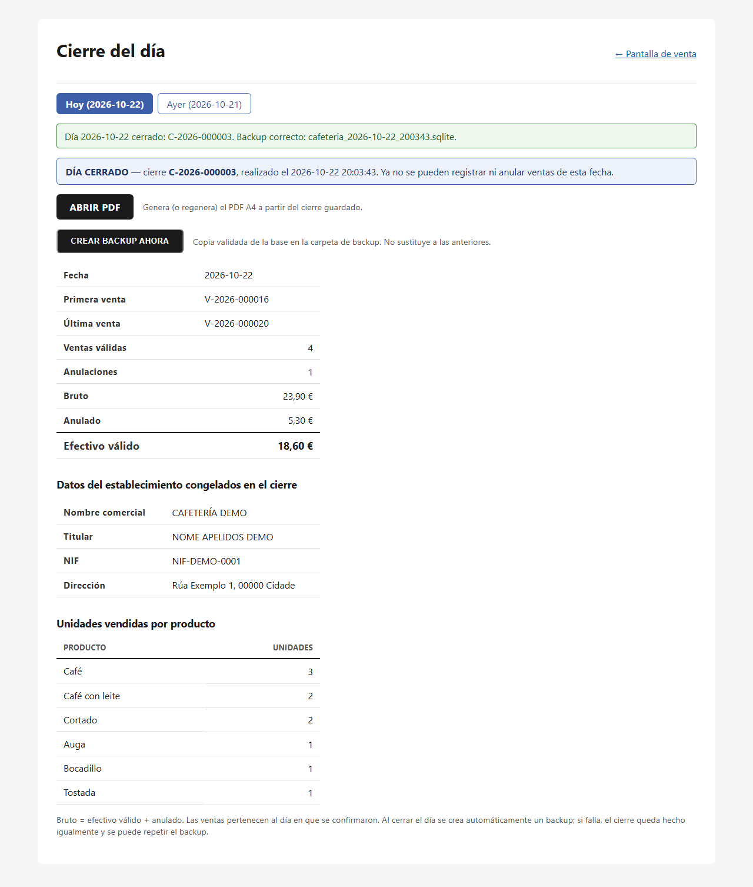
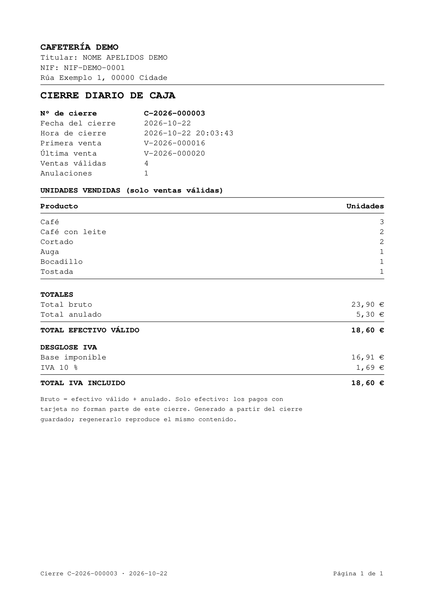
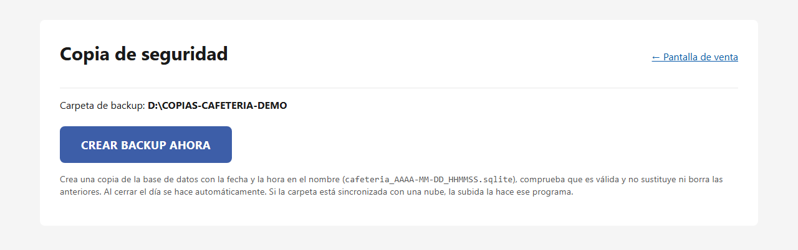
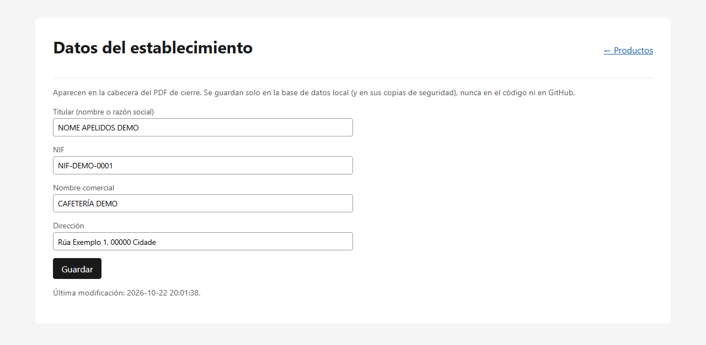
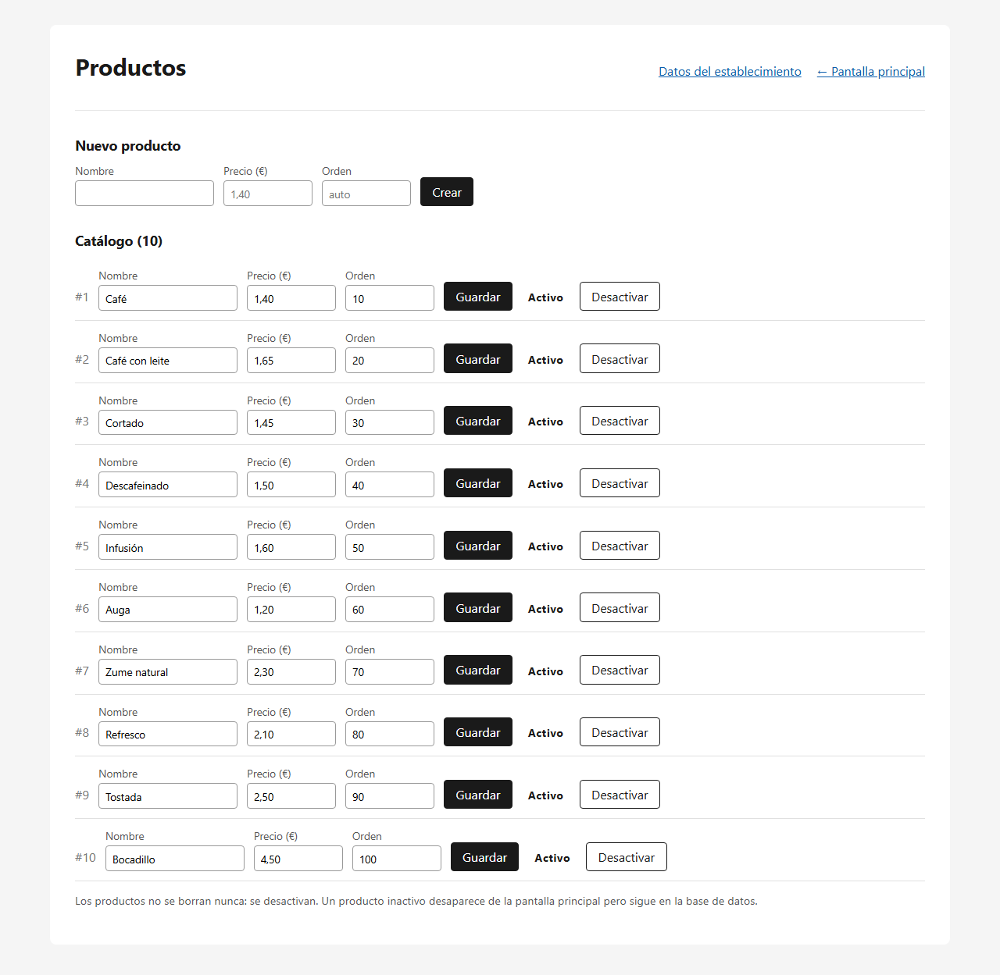

# Manual de usuario

Guía curta de uso, no mesmo orde no que se usa a aplicación nun día normal.

---

## 1. Iniciar a aplicación

```bash
powershell -ExecutionPolicy Bypass -File scripts\start.ps1
```

E abrir no navegador: **<http://127.0.0.1:5000>**

Para deter a aplicación, `Ctrl+C` na xanela onde se arrancou.

Para probar con datos de demostración, antes de arrancar:

```bash
.venv\Scripts\python.exe scripts\seed_demo.py
$env:CAFETERIA_DB = "data\demo.sqlite"
```

---

## 2. Seleccionar produtos

A pantalla principal ten **dúas zonas**:

- á **esquerda**, os botóns dos produtos activos, con nome e prezo;
- á **dereita**, a venda en curso.

**Cada pulsación sobre un produto engade unha unidade.** Se o produto xa está na
venda, súmase á cantidade que xa tiña.

Por cada liña móstrase o nome, o prezo unitario, a cantidade e o subtotal.
Debaixo, o **TOTAL**.



*A botoeira e a venda en curso. Os datos son de demostración.*

---

## 3. Modificar cantidades

Cada liña da venda ten tres controis:

| Control | Que fai |
|---|---|
| **+** | Engade unha unidade |
| **−** | Quita unha unidade. Ao chegar a cero, a liña desaparece |
| **✕** | Elimina a liña enteira, teña a cantidade que teña |

E debaixo da venda, **Cancelar venda** baléiraa por completo.

Todo isto ocorre **antes de cobrar**: mentres non se cobre, non se garda nada na
base de datos.

Os tres controis vense en cada liña da captura anterior.

---

## 4. Cobrar

Pulsar **COBRAR EN EFECTIVO**.

A venda gárdase e móstrase unha mensaxe como:

```
Venda V-2026-000001 rexistrada — 4,45 €
```

A venda en curso baléirase e a pantalla queda lista para a seguinte persoa.

**Cousas a ter en conta:**

- O botón está desactivado se non hai ningunha liña.
- Tamén está desactivado se **o día de hoxe xa está pechado**.
- Se o gardado fallase, a venda **non se baleira**, para poder reintentar sen
  volver pulsar todos os produtos.



*Tras cobrar, a venda en curso baléirase e a pantalla queda lista para a seguinte persoa.*

---

## 5. Consultar o histórico

Desde **Histórico**, na cabeceira.

Móstranse todas as vendas confirmadas, **da máis recente á máis antiga**, con
data e hora, número de venda, importe e estado: `VÁLIDA` ou `ANULADA`.



*As vendas dun día pechado amosan «Día cerrado» no lugar do botón ANULAR.*

---

## 6. Anular unha venda

No histórico, pulsar **ANULAR** na liña correspondente. O navegador pide
confirmación antes de facer nada.

**Que ocorre ao anular:**

- a venda **segue no histórico**, marcada como `ANULADA`, coa data e hora da
  anulación;
- consérvanse o número, o importe e todas as liñas;
- **non se borra nada**.

**Que non se pode facer:**

- unha anulación **non se pode desfacer**;
- non se poden anular vendas dun **día xa pechado**: no seu lugar aparece
  «Día cerrado» en vez do botón.

A confirmación é o diálogo propio do navegador, non unha pantalla da aplicación.

---

## 7. Resumo do día

Desde **Resumo do día**. Mostra, para o día de hoxe:

| Dato | Que é |
|---|---|
| Efectivo válido | Suma das vendas válidas |
| Vendas válidas | Cantas son |
| Anulado | Suma das vendas anuladas, co seu importe orixinal |
| Vendas anuladas | Cantas son |
| Unidades por produto | Só das vendas **válidas** |

É unha **consulta**: non pecha nada nin modifica a base.

Unha venda pertence ao día no que se confirmou, aínda que se anule máis tarde.



---

## 8. Pechar o día

Desde **Peche do día**.

A pantalla mostra primeiro unha **previsualización** coas cifras que quedarían
gardadas: data, primeira e última venda, vendas válidas, anulacións, bruto,
anulado, efectivo válido, os datos do establecemento e as unidades por produto.

Os botóns **Hoxe** / **Onte** permiten escoller entre esas dúas datas, para
poder facer o peche despois da medianoite.

Ao pulsar **CERRAR DÍA**, o navegador pide confirmación. Despois:

- o día queda pechado e recibe un número correlativo (`C-2026-000001`);
- **xa non se poden rexistrar nin anular vendas desa data**;
- **non hai reapertura**;
- créase automaticamente unha copia de seguridade.

Se a copia fallase, o peche queda feito igualmente e a copia pódese repetir.



*Previsualización: o día segue aberto e aínda non se gardou nada.*



*Xa pechado: aparece o número de peche, o nome do backup e o botón ABRIR PDF.*

---

## 9. Abrir o PDF

Cando o día está pechado, na mesma pantalla aparece **ABRIR PDF**.

Xera e abre o PDF A4 do peche, que inclúe os datos do establecemento, o número e
a data do peche, a primeira e a última venda, as vendas válidas e as anulacións,
as unidades por produto, os totais e o desglose de IVE.

Pódese **rexenerar as veces que faga falla**: o documento é sempre o mesmo. O
arquivo gárdase en `exports/` cun nome como:

```
cierre_2026-10-21_C-2026-000001.pdf
```

Para imprimilo, `Ctrl+P` desde o visor do navegador.



---

## 10. Crear unha copia de seguridade

Normalmente non fai falla: **créase soa ao pechar o día**.

Para facela a man, ou para repetila se fallou, usar **CREAR BACKUP AHORA** na
pantalla de peche, ou a pantalla de **Backup**.

Cada copia:

- lévase a unha carpeta externa configurada no equipo;
- **valídase** antes de darse por boa;
- ten un nome con data e hora, e **nunca substitúe** a unha anterior.

Se a carpeta non está dispoñible, avísase e **non se crea ningunha copia**.



---

## Datos do establecemento

Desde **Produtos → Datos do establecemento**. Son catro: titular, NIF, nome
comercial e enderezo.

Aparecen na cabeceira do PDF e **son obrigatorios para poder pechar o día**.
Gárdanse só na base de datos local.

Cada peche **conxela** os datos vixentes nese momento: cambialos despois non
altera os peches xa feitos.



*Os valores da captura son ficticios: os reais só existen na base local.*

---

## Produtos

Desde **Xestionar produtos**: crear, editar o nome e o prezo, e activar ou
desactivar.

Os prezos escríbense como `1,40` ou `1.40`, con dous decimais como máximo.

**Un produto non se borra nunca, desactívase.** Un produto desactivado
desaparece da botoeira pero segue na base, porque as vendas pasadas o
referencian.



---

## Resumo rápido

| Quero… | Vou a… |
|---|---|
| Cobrar | Pantalla de venda |
| Ver o que levo vendido | Resumo do día |
| Corrixir unha venda mal cobrada | Histórico → ANULAR |
| Pechar a caixa | Peche do día → CERRAR DÍA |
| Imprimir o peche | Peche do día → ABRIR PDF |
| Repetir unha copia de seguridade | Backup → CREAR BACKUP AHORA |
| Cambiar prezos | Xestionar produtos |
