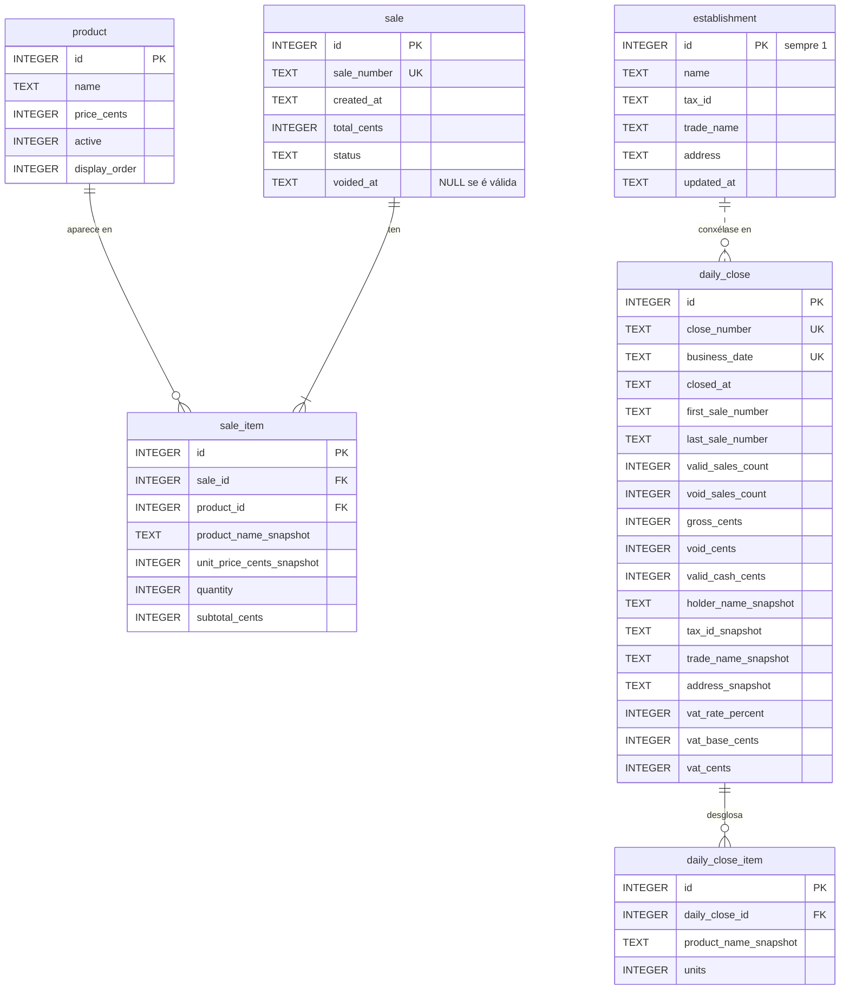

# Modelo de datos

Base de datos **SQLite**, nun só arquivo local. Seis táboas.

O esquema créase e actualízase automaticamente en cada arranque mediante
migracións **idempotentes**: engádense as táboas e columnas que falten, e
**nunca se borran datos**.

---

## Diagrama entidade-relación



A relación entre `establishment` e `daily_close` debúxase con liña descontinua
porque **non é unha clave allea**: os datos **cópianse** no peche ao pechar o
día. Explícase máis abaixo.

---

## As táboas

### `product` — catálogo

| Columna | Tipo | Restricións |
|---|---|---|
| `id` | INTEGER | PK, autoincremental |
| `name` | TEXT | NOT NULL |
| `price_cents` | INTEGER | NOT NULL, `>= 0` |
| `active` | INTEGER | NOT NULL, `IN (0, 1)`, por defecto 1 |
| `display_order` | INTEGER | NOT NULL, por defecto 0 |

Índice `idx_product_visible` sobre `(active, display_order, name)`: é a consulta
da botoeira, a máis frecuente.

**Un produto non se borra nunca, desactívase.** Se se borrase, as liñas de venda
que o referencian quedarían orfas.

### `sale` — cabeceira da venda

| Columna | Tipo | Restricións |
|---|---|---|
| `id` | INTEGER | PK, autoincremental |
| `sale_number` | TEXT | NOT NULL, **UNIQUE** |
| `created_at` | TEXT | NOT NULL, `AAAA-MM-DD HH:MM:SS` local |
| `total_cents` | INTEGER | NOT NULL, `>= 0` |
| `status` | TEXT | NOT NULL, `IN ('VALID', 'VOID')`, por defecto `VALID` |
| `voided_at` | TEXT | NULL mentres a venda é válida |

Índice `idx_sale_fecha` sobre `created_at`.

Numeración `V-<ano>-<6 díxitos>`, correlativa por ano. O `UNIQUE` é a garantía
final de que non hai dous números iguais.

### `sale_item` — liñas da venda

| Columna | Tipo | Restricións |
|---|---|---|
| `id` | INTEGER | PK, autoincremental |
| `sale_id` | INTEGER | NOT NULL, **FK → `sale.id`** |
| `product_id` | INTEGER | NOT NULL, **FK → `product.id`** |
| `product_name_snapshot` | TEXT | NOT NULL |
| `unit_price_cents_snapshot` | INTEGER | NOT NULL, `>= 0` |
| `quantity` | INTEGER | NOT NULL, **`> 0`** |
| `subtotal_cents` | INTEGER | NOT NULL, `>= 0` |

Índice `idx_sale_item_venta` sobre `sale_id`.

As dúas columnas `*_snapshot` son o corazón do modelo histórico: gardan o nome e
o prezo **do momento do cobro**. `product_id` conserva a referencia ao produto,
pero o que se mostra e se suma sempre é o snapshot.

### `daily_close` — peche do día

| Columna | Tipo | Restricións |
|---|---|---|
| `id` | INTEGER | PK, autoincremental |
| `close_number` | TEXT | NOT NULL, **UNIQUE** |
| `business_date` | TEXT | NOT NULL, **UNIQUE** |
| `closed_at` | TEXT | NOT NULL |
| `first_sale_number` | TEXT | NULL se o día non tivo vendas |
| `last_sale_number` | TEXT | NULL se o día non tivo vendas |
| `valid_sales_count` | INTEGER | NOT NULL, `>= 0` |
| `void_sales_count` | INTEGER | NOT NULL, `>= 0` |
| `gross_cents` | INTEGER | NOT NULL, `>= 0` |
| `void_cents` | INTEGER | NOT NULL, `>= 0` |
| `valid_cash_cents` | INTEGER | NOT NULL, `>= 0` |
| `holder_name_snapshot` | TEXT | titular no momento do peche |
| `tax_id_snapshot` | TEXT | NIF no momento do peche |
| `trade_name_snapshot` | TEXT | nome comercial no momento do peche |
| `address_snapshot` | TEXT | enderezo no momento do peche |
| `vat_rate_percent` | INTEGER | tipo de IVE conxelado |
| `vat_base_cents` | INTEGER | base impoñible |
| `vat_cents` | INTEGER | cota de IVE |

Dúas restricións merecen atención:

- **`business_date` é UNIQUE.** É o que impide, a nivel de base de datos, que un
  día se peche dúas veces.
- **`CHECK (gross_cents = valid_cash_cents + void_cents)`.** A regra contable
  faina cumprir a propia base, non só o código.

As oito columnas `*_snapshot` e `vat_*` admiten NULL **só** porque se engadiron
despois de que xa existisen peches; o código esíxeas sempre ao pechar.

### `daily_close_item` — desglose do peche

| Columna | Tipo | Restricións |
|---|---|---|
| `id` | INTEGER | PK, autoincremental |
| `daily_close_id` | INTEGER | NOT NULL, **FK → `daily_close.id`** |
| `product_name_snapshot` | TEXT | NOT NULL |
| `units` | INTEGER | NOT NULL, **`> 0`** |
| | | **UNIQUE (`daily_close_id`, `product_name_snapshot`)** |

Unidades vendidas por produto, **só de vendas válidas**, conxeladas ao pechar.
O `UNIQUE` impide que un produto apareza dúas veces no mesmo peche.

### `establishment` — datos do establecemento

| Columna | Tipo | Restricións |
|---|---|---|
| `id` | INTEGER | PK, **`CHECK (id = 1)`** |
| `name` | TEXT | NOT NULL — titular |
| `tax_id` | TEXT | NOT NULL — NIF |
| `trade_name` | TEXT | nome comercial |
| `address` | TEXT | NOT NULL — enderezo |
| `updated_at` | TEXT | NOT NULL |

O `CHECK (id = 1)` garante **unha soa fila**: non é unha táboa de rexistros,
é a configuración do establecemento. Estes datos nunca están no código nin no
repositorio; só nesta táboa, e por tanto nas copias de seguridade.

---

## Claves alleas

```
sale_item.sale_id        → sale.id
sale_item.product_id     → product.id
daily_close_item.daily_close_id → daily_close.id
```

`PRAGMA foreign_keys = ON` actívase en **todas** as conexións. Non é o
comportamento por defecto de SQLite, e sen el as claves alleas non se
comprobarían.

---

## Os tres niveis de histórico

O modelo conxela a información en tres momentos distintos, cada un máis
definitivo que o anterior:

| Nivel | Que conxela | Cando | Onde |
|---|---|---|---|
| 1. Venda | Nome e prezo do produto | Ao cobrar | `sale_item.*_snapshot` |
| 2. Peche | Unidades por produto e cifras do día | Ao pechar | `daily_close_item`, `daily_close` |
| 3. Peche | Datos do establecemento e IVE | Ao pechar | `daily_close.*_snapshot`, `vat_*` |

A consecuencia práctica: **o PDF dun peche xérase só a partir de
`daily_close` e `daily_close_item`**. Non consulta vendas, nin produtos, nin a
configuración actual. Por iso rexenerar un peche antigo produce exactamente o
mesmo documento, aínda que despois cambiasen os prezos ou os datos do
establecemento.

---

## Regras de integridade

| Regra | Como se garante |
|---|---|
| Unha venda confirmada non se borra | Non existe ningún `DELETE` sobre `sale` nin `sale_item` no código. Hai unha proba que falla se alguén o engade |
| Unha venda anulada non volve a válida | A anulación é `UPDATE ... WHERE id = ? AND status = 'VALID'` |
| Un día pechado non admite vendas nin anulacións | Compróbase **dentro** da transacción que escribiría, non antes |
| Un día non se pecha dúas veces | `business_date UNIQUE` + comprobación na transacción |
| Un peche non se edita nin se borra | Non existe ningún `UPDATE` nin `DELETE` sobre as táboas de peche |
| Os importes cadran | `CHECK (gross_cents = valid_cash_cents + void_cents)` |

---

## Importes

**Todos os importes son enteiros de céntimos.** Non hai ningún `REAL` nin
`FLOAT` no esquema. A conversión a texto (`4,45 €`) faise só ao mostrar.

O motivo explícase en [DECISIONS_TECNICAS.md](DECISIONS_TECNICAS.md).
